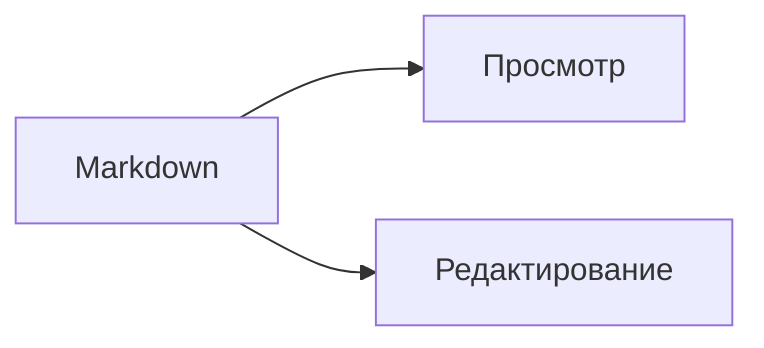
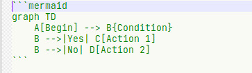

# AnotherMarkdown + Translate-RU

**[Версия 0.1.12-ru.37](https://github.com/maljaev-alex/markdown-ru/releases/tag/0.1.12-ru.37)** — просмотр, визуальное редактирование Markdown и перевод на русский прямо в Notepad++.

Исходный текст остаётся обычным файлом `.md` или `.mdc`. В соседней панели можно читать
документ с оформлением, править его без ручного ввода разметки, переходить по ссылкам
в исходники и работать с отдельным черновиком перевода.

[Скачать ZIP x64](https://github.com/maljaev-alex/markdown-ru/releases/download/0.1.12-ru.37/AnotherMarkdown-0.1.12-ru.37-x64.zip) ·
[Репозиторий форка](https://github.com/maljaev-alex/markdown-ru) ·
[Сборки и изменения RU](https://github.com/maljaev-alex/markdown-ru/releases) ·
[Справка визуального редактора](docs/visual-editor.md) ·
[Подробная справка по переводу](docs/translation-ru.md) ·
[Сообщить о проблеме](https://github.com/maljaev-alex/markdown-ru/issues)

Проект основан на [AnotherMarkdown от ezyuzin](https://github.com/ezyuzin/NppAnotherMarkdown),
версия 0.1.12. Upstream разработал панель предпросмотра на WebView2 и интеграцию
Markdown-расширений. Этот форк добавляет перевод через CLI/API, русские настройки
перевода, поддержку `.mdc` и визуальное редактирование на CKEditor 5.
Авторство upstream и его лицензия MIT сохранены; CKEditor поставляется по GPL-2.0-or-later.

## Содержание

- [Возможности](#что-умеет-плагин)
- [Установка и обновление](#установка-и-обновление)
- [Быстрый старт](#быстрый-старт)
- [Панель, меню и кнопки](#панель-меню-и-кнопки)
- [Визуальное редактирование](#визуальное-редактирование)
- [Синхронизация с исходником](#синхронизация-с-исходником)
- [Ссылки и история файлов](#ссылки-и-история-файлов)
- [Просмотр изображений](#просмотр-изображений)
- [Перевод на русский](#перевод-на-русский)
- [Перевод по частям и защита Markdown](#ускорение-перевода)
- [Подключение через CLI](#перевод-через-cli)
- [Подключение через API и прокси](#перевод-через-api)
- [Настройки просмотра](#настройки-предпросмотра)
- [Настройки и данные на диске](#настройки-и-данные-на-диске)
- [Решение проблем и ограничения](#если-что-то-не-работает)
- [Все расширения Markdown](#расширения-markdown)
- [Сборка и проверки](#справка-и-сборка)
- [Авторы и лицензии](#авторы-зависимости-и-лицензия)

## Что умеет плагин

| Возможность | Как работает |
| --- | --- |
| Просмотр Markdown | Панель на **Microsoft Edge WebView2**, локальные изображения и ссылки, светлая и тёмная темы, масштаб. |
| Визуальный редактор | Русский интерфейс CKEditor 5: заголовки, оформление текста, ссылки, списки, задачи, таблицы, изображения, цитаты и код; результат — Markdown + GFM. |
| Правки с двух сторон | Изменения переходят между панелью и буфером Notepad++; независимые правки объединяются, пересекающиеся требуют выбора. |
| Навигация по документу | Двусторонняя синхронизация курсора, выделения и прокрутки в просмотре и редакторе, без переключения фокуса. |
| Ссылки в исходники | Открытие локального файла любого расширения в Notepad++, в том числе по адресу `file.bsl:120:7`. |
| История файлов | Кнопки **Назад по файлам** и **Вперёд по файлам** на основной панели Notepad++. |
| Управление панелью | Автоматическое скрытие на других типах файлов, восстановление на Markdown и сохранение включённого состояния между запусками. |
| Изображения | Вставка в документ и отдельное окно просмотра с масштабированием, перемещением и сохранением геометрии окна. |
| Расширения | 28 переключаемых расширений: формулы, Mermaid, PlantUML, подсветка кода, сноски, уведомления, QR-коды, панорамы и другие. |
| Перевод | Русский перевод через 11 встроенных CLI-профилей, произвольный CLI или один из четырёх API-протоколов. |
| Подключения и модели | Независимые настройки CLI/API, несколько API-профилей, получение каталогов моделей, подтверждённые варианты effort и Fast. |
| Длинные документы | Разделение по структуре Markdown, до восьми одновременных запросов, контекст соседних частей и контроль целостности. |
| Сохранность кода | Защита кода и формул; отдельный перевод распознанных комментариев и пояснений внутри примеров. |
| Черновик перевода | Собственное редактирование, сохранение в другой файл, перенос относительных ссылок и изображений при экспорте. |

В `ru.37` объединены доработки после публичной `ru.21`: визуальный редактор,
синхронизация, просмотр изображений, локальные ссылки с позициями, история файлов,
новые настройки отображения и восстановление панели. Подробная история — в
[CHANGELOG.md](CHANGELOG.md). Описание ниже относится к текущей сборке;
старые скриншоты upstream иллюстрируют только соответствующее расширение.

## Установка и обновление

Требуются **Windows, 64-битный Notepad++, .NET Framework 4.7.2 или новее**
и [Microsoft WebView2 Runtime](https://developer.microsoft.com/microsoft-edge/webview2/).
Сборка RU предназначена для x64; разрядность плагина должна совпадать с Notepad++.

1. Скачайте актуальный опубликованный архив из
   [релизов этого форка](https://github.com/maljaev-alex/markdown-ru/releases).
2. Закройте Notepad++ и сохраните резервную копию прежней папки плагина.
   Если меняли CSS или assets, сохраните свои версии отдельно.
3. Распакуйте содержимое архива в `Notepad++\plugins\AnotherMarkdown`,
   например `C:\Program Files\Notepad++\plugins\AnotherMarkdown`.
4. Запустите Notepad++. В меню **Плагины** появится **AnotherMarkdown + Translate-RU**.

`AnotherMarkdown.dll`, `lib`, `assets` и `README.md` должны находиться непосредственно
в папке `AnotherMarkdown`, без дополнительной вложенной папки из архива.
Имя DLL, каталог установки и `AnotherMarkdown.ini` сохранены для совместимости.

```text
Notepad++/plugins/AnotherMarkdown/
├── AnotherMarkdown.dll
├── lib/
├── assets/
│   ├── editor/
│   └── markdown/
├── docs/
├── editor/
├── licenses/
├── README.md
└── TRANSLATION-RU.md
```

Это основные части архива, а не полный список. Переносите **всё содержимое ZIP**:
одного DLL недостаточно. Для чтения и редактирования не нужны CLI, API-ключи,
Node.js или Python. Подключение к модели требуется только для перевода.

Если Windows заблокировала загруженные DLL, откройте их свойства и нажмите
**Разблокировать**, включая DLL в `lib`. При ошибке совместимости также проверьте
разрядность Notepad++, наличие .NET Framework и WebView2 Runtime.


Plugin Admin устанавливает upstream AnotherMarkdown. Обновление через него может
заменить эту сборку версией без перевода; для обновления RU используйте релизы форка.
Для отката закройте редактор и восстановите резервную копию папки плагина.

## Быстрый старт

### Прочитать и изменить документ

1. Сохраните документ как `.md` или `.mdc` и нажмите значок **М** на панели
   инструментов Notepad++ либо **Плагины → AnotherMarkdown + Translate-RU → Показать / скрыть Markdown**.
2. Документ откроется в режиме **Просмотр**. Нажмите **Редактирование**, чтобы
   использовать визуальную панель форматирования.
3. Измените текст в панели или исходнике. Правки автоматически попадут в другой редактор.
4. Нажмите **Ctrl+S** или штатную команду **Сохранить** в Notepad++ для записи на диск.

### Перевести на русский

1. Откройте **Настройки → Перевод**. Выберите **CLI** либо **API**.
2. Для CLI укажите установленный и авторизованный клиент; для API добавьте
   подключение, адрес, ключ при необходимости и модель. Нажмите **Сохранить**.
3. Нажмите **Перевести**, дождитесь результата. При необходимости исправьте его
   в режиме **Редактирование**.
4. Сохраните перевод через **Сохранить как…** в другой файл. **Оригинал** возвращает
   исходный документ, **Перевод** — уже полученный черновик.

## Панель, меню и кнопки

Панель можно закрепить рядом с исходником, изменить её размер или превратить
в отдельное окно двойным нажатием на заголовок. Крестик плавающего окна скрывает
панель; сам документ остаётся открытым. Кнопка **М** и отметка в меню отражают её видимость.

При переходе на другой Markdown-документ открывается **Просмотр**.
При переходе на файл другого типа панель скрывается и возвращается при переходе
на Markdown, если была включена. Ручное закрытие отключает автоматическое открытие.
Выбор сохраняется между запусками Notepad++: панель восстанавливается после загрузки
сессии либо при первом переходе к Markdown. Автоматическое скрытие этот выбор не сбрасывает.

| Команда | Действие |
| --- | --- |
| **Показать / скрыть Markdown**, кнопка **М** | Открывает или закрывает панель для текущего Markdown-файла. |
| **Синхронизировать курсор и выделение** | Включает двустороннюю привязку позиции и основного выделения. |
| **Синхронизировать прокрутку** | Отдельно включает двустороннюю привязку видимой части документа. |
| **Назад по файлам**, **Вперёд по файлам** | Переходит по истории вкладок; команды есть и в меню, и на панели Notepad++. |
| **Настройки** | Открывает первую страницу настроек — **Просмотр**; перевод настраивается на соседней странице. |
| **Справка** | Открывает установленный `README.md` в Notepad++ и в панели. |
| **О плагине** | Показывает версию, авторов и сведения о проекте. |

В верхней строке панели доступны **Просмотр**, **Редактирование** и **Настройки**.
Команды перевода меняются по состоянию документа:

| Кнопка | Когда нужна |
| --- | --- |
| **Перевести** | Получить первый перевод текущего текста. |
| **Перевод** | Вернуться к готовому черновику без нового запроса к модели. |
| **Оригинал** | Вернуться к исходному документу. |
| **Перевести заново** | Заменить черновик новым переводом после подтверждения. |
| **Отмена** | Прервать выполняющийся запрос перевода. |
| **Сохранить как…** | Сохранить перевод в другой Markdown-файл; для оригинала кнопка не показывается. |
| **Разобрать конфликт** | Согласовать пересекающиеся правки исходника и визуального редактора. |
| **Повторить** | Повторить применение визуальных правок после ошибки; появляется при соответствующем состоянии редактора. |

Статус синхронизации расположен справа в верхней строке. Он сообщает о несохранённых
правках, режиме черновика, конфликте или ошибке. Отдельной пустой нижней строки нет.

## Визуальное редактирование

Редактор использует **CKEditor 5** с русской панелью инструментов и выдаёт
**Markdown + GitHub Flavored Markdown (GFM)**. Панель форматирования появляется
в режиме **Редактирование**; в узком окне кнопки переносятся на следующие строки.

### Форматирование

| Инструмент | Возможности |
| --- | --- |
| Абзац и заголовки | Обычный текст и уровни H1–H6. |
| Оформление текста | Полужирный, курсив, зачёркивание, встроенный код. |
| Ссылки | Создание и редактирование адреса, автоматическое распознавание ссылок, переход к цели. |
| Списки | Маркированные, нумерованные, вложенные и задачи с чекбоксами. |
| Цитата и разделитель | Блочная цитата и горизонтальная линия. |
| Блок кода | Обычный текст, JavaScript, TypeScript, C#, Python, PowerShell, SQL, BSL, JSON, HTML, CSS, Bash и Mermaid в меню языков. |
| Таблица | Вставка GFM-таблицы, добавление и удаление строк/столбцов; сохранение существующего выравнивания столбцов. |
| Изображение | Вставка по URL, загрузка файла и вставка из буфера обмена; альтернативный текст и ссылка на изображении. |
| Отмена и повтор | Undo/Redo в визуальном редакторе. |

Работает автоформатирование Markdown при вводе. При вставке форматированного
текста, в том числе из Office, остаётся поддерживаемое оформление.
Цвет текста, произвольный размер шрифта, объединение ячеек и другие операции,
требующие HTML, в панели не предлагаются.

**Просмотр** использует рендерер с выбранными расширениями. Поэтому, например,
Mermaid в редакторе выглядит как блок кода, а в просмотре — как диаграмма.
Язык блока кода и включение подсветки синтаксиса в просмотре — разные настройки.

### Переносы строк и сохранение исходной записи

По умолчанию обычные переносы внутри Markdown-абзаца отображаются как пробелы,
и текст заполняет ширину панели. Опция **Настройки → Просмотр → Сохранять переносы
строк в редакторе** показывает строки исходника отдельно. Переключение меняет
отображение и не переписывает файл.

Абзацы, строки кода и явные разрывы Markdown сохраняются в обоих режимах.
**Shift+Enter** вставляет явный разрыв, совместимый с обычными Markdown-просмотрщиками.

Нетронутые блоки сохраняют свою исходную запись. При текстовой правке плагин
старается сохранить маркеры списков, пробелы, пустые строки, разделители выделения,
ссылочную форму ссылок и отступы таблиц. Результат проверяется повторным разбором.
Если структурное изменение нельзя перенести без изменения смысла, изменённый
блок сериализуется в Markdown заново; побайтовая неизменность такого блока не обещается.

YAML front matter, существующий HTML и распознанные расширения вне GFM отображаются
в редакторе как защищённые блоки с исходным текстом. Их правят в Notepad++;
соседние визуальные правки их не переписывают. В штатном просмотре существующий
HTML показывается текстом, обработчики событий из него не выполняются.

### Сохранение, Undo и конфликты

Правки оригинала автоматически синхронизируются с **буфером Notepad++** после
короткой паузы ввода. На диск файл записывает штатная команда **Сохранить** или
**Ctrl+S**, в том числе из визуального редактора. До этого документ остаётся изменённым
и несохранённым. Отдельной кнопки сохранения оригинала в панели нет.

Undo/Redo доступны с обеих сторон. Обновление из исходника сбрасывает локальную
историю визуального редактора; история Notepad++ сохраняется. Файлы, открытые
только для чтения, остаются доступными для просмотра, но не для визуальной правки.

Перед применением правок проверяются активный документ и его исходная версия.
Независимые изменения сливаются автоматически. Если два редактора изменили
пересекающийся фрагмент, появляется **Разобрать конфликт**: можно выбрать исходник,
вариант визуального редактора или вручную отредактировать итог. Запись продолжается
после согласования всех конфликтов. Запоздавший ответ другой вкладки в новый файл не записывается.

Если файл изменён другой программой, **Ctrl+S из визуального редактора** остановит
перезапись и предложит сначала согласовать изменение в Notepad++; визуальные
правки останутся во вкладке. Сохранение через меню самого Notepad++ использует
штатное поведение редактора.

### Вставка изображений

Для загрузки и вставки растровых изображений поддерживаются **PNG, JPEG, GIF,
WebP и BMP**, с ограничением размера около 20 МБ на изображение.
В оригинале файл картинки сразу создаётся рядом с документом в каталоге
`<имя документа>.assets`, в Markdown появляется относительная ссылка.
Например, у `guide.md` это `guide.assets/image-<id>.png`.
Отмена вставки удаляет ссылку из текста, но не удаляет уже созданный файл картинки.

В переводе новая картинка хранится в памяти до **Сохранить как…** и записывается
рядом с новым документом при экспорте. Для ссылки на уже существующее изображение
доступна вставка по URL. Детали — в [справке визуального редактора](docs/visual-editor.md).

## Синхронизация с исходником

Курсор, основной диапазон выделения и прокрутка синхронизируются **в обе стороны**:
из Notepad++ в панель и из панели в исходник. Это работает в **Просмотре** и
**Редактировании**, включая кириллицу, Unicode и таблицы.

- **Синхронизировать курсор и выделение** и **Синхронизировать прокрутку** —
  независимые переключатели в меню плагина; по умолчанию оба включены.
- Фокус остаётся в активном редакторе. В просмотре видны пассивная каретка и
  выделение; при работе в панели каретка видна и в неактивном исходнике, с цветом его темы.
- Сохраняется направление выделения. Дополнительные курсоры и прямоугольное
  выделение Notepad++ не воспроизводятся в панели как отдельные диапазоны.
- Прокрутка привязывается к соответствующему тексту, а не к одинаковому проценту
  полосы: ширина строк и высота элементов в двух редакторах различаются.
- Невидимые маркеры Markdown сопоставляются с ближайшей отображаемой позицией,
  изображения и защищённые блоки — с границей блока.
- Навигация не меняет текст и не создаёт шагов Undo. При конфликте она
  приостанавливается до его разрешения. Для переведённого черновика привязка к оригиналу отключена.

При обновлении со старых режимов слежения новые переключатели включаются по умолчанию;
дальнейший выбор сохраняется в настройках.

## Ссылки и история файлов

### Переход к файлу, строке и столбцу

Локальные ссылки открывают файлы **в Notepad++**, без ограничения по расширению:
можно ссылаться на Markdown, BSL, JSON, XML и другие исходники.
Поддерживаются относительные пути, абсолютные Windows-пути и `file:///` URL,
включая пробелы и кириллицу в именах.

```markdown
[Соседняя инструкция](docs/guide.md)
[Модуль, строка 120](src/Module.bsl:120)
[Модуль, строка 120, столбец 7](src/Module.bsl:120:7)
[Локальный файл](D:/Project/src/Module.bsl:120:7)
[Файл с пробелами](<file:///D:/Project/Мои документы/guide.md:25>)
```

Это примеры адресов, а не ссылки на файлы данного репозитория. Нумерация строк
и столбцов начинается с **1**. После открытия указанная строка располагается
в видимой области исходника; для другого типа файла фокус получает редактор текста.

В **Просмотре** переход выполняется обычным кликом. В **Редактировании** используйте
**Ctrl+клик**, **Alt+Enter** или кнопку перехода во всплывающей панели ссылки;
обычный клик позволяет её изменить. Исходный адрес и суффикс позиции сохраняются
в Markdown. Внешние HTTP/HTTPS-ссылки открываются системным обработчиком;
для поддерживаемых `mailto` и FTP/FTPS также используется приложение по умолчанию.
Ссылки со схемами `javascript:` и `data:` не используются для переходов.

Опция **Показывать адреса ссылок** включает зелёную подсказку при наведении или
выборе ссылки с клавиатуры. Локальный адрес показывается в читаемом виде,
включая кириллицу и позицию. Изменение настройки применяется без перезагрузки
документа и сброса режима редактирования.

### Назад и вперёд по вкладкам

Кнопки **Назад по файлам** и **Вперёд по файлам** рядом с **М** запоминают посещённые
вкладки всех типов, в том числе открытые из Markdown-ссылок. Закрытые вкладки
пропускаются. После возврата назад переход на новый файл очищает историю вперёд.
Недоступное направление выключается; значки учитывают светлую и тёмную тему.
Это история вкладок текущего сеанса, а не список для повторного открытия закрытых файлов.

## Просмотр изображений

В режиме **Просмотр** наведите указатель на картинку и нажмите лупу в её правом
верхнем углу. У картинки без ссылки можно нажать и на само изображение.
Если картинка является ссылкой, лупа позволяет открыть её отдельно от перехода по ссылке.

Изображение открывается в отдельном окне поверх Notepad++; документ остаётся доступным.
По умолчанию включён режим **Вписать**. Окно можно перемещать, изменять его размер
и разворачивать. Положение, размер и развёрнутое состояние сохраняются, в том числе
между запусками Notepad++; после изменения набора мониторов окно возвращается в видимую область.

| Действие | Управление |
| --- | --- |
| Увеличить / уменьшить | Колесо мыши, кнопки **+ / −**, клавиши **+ / −**. |
| Показать целиком | **Вписать**. |
| Исходный масштаб | **100%** или клавиша **0**. |
| Переключить 100% / вписать | Двойной клик по изображению. |
| Переместить увеличенную картинку | Перетаскивание мышью. |
| Закрыть окно | Крестик или **Esc**. |

Просмотр изображений доступен и для перевода в режиме **Просмотр**.

## Перевод на русский

Переводится текущий текст документа из буфера, включая несохранённые изменения.
Плагин получает результат от выбранной модели; качество перевода зависит от неё.
Язык назначения штатного режима — русский.

Вращающийся значок означает ожидание ответа, а не процент готовности.
При переводе по частям панель также показывает число завершённых частей.
При изменении текста, переходе к другому документу или отмене старый результат
не подменяет новый предпросмотр. Для CLI отмена завершает запущенный процесс
и его дочерние процессы. Для API прекращается ожидание в плагине; обработка
на сервере и учёт запроса зависят от самого сервиса.

Перевод — отдельный редактируемый черновик. Его изменения не попадают в оригинал.
**Сохранить как…** записывает перевод в другой Markdown-файл. **Перевод** возвращает
существующий черновик; **Перевести заново** заменяет его после подтверждения.
Черновики сохраняются при переключении вкладок в текущем сеансе, но исчезают при выходе
из Notepad++. Перед выходом сохраните нужный перевод.
Подробности формата, изображений и конфликтов — в [справке редактора](docs/visual-editor.md).

При сохранении перевода в другую папку относительные Markdown-ссылки пересчитываются,
чтобы продолжать указывать на прежние файлы и изображения. URL внутри существующего
HTML не переписываются. Новый файл записывается в **UTF-8 без BOM**.
Оригинал сохраняет свою кодировку и переводы строк; символ, который нельзя представить
в его кодировке, вызывает ошибку вместо повреждения текста.

Повторный запрос того же текста с теми же параметрами использует кэш в памяти:
до **8 результатов / 4 млн символов перевода** суммарно. Кэш не записывается на диск
и исчезает при завершении работы плагина.

В YAML front matter инструкция модели переводит описательные значения
`description`, `title` и `summary`, включая многострочные. Ключи, `name`,
идентификаторы, пути, globs и флаги требуется сохранять.
Это перевод текста правила, а не выполнение содержащихся в нём инструкций.

## Ускорение перевода

### Разбиение и параллельность

В **Настройки → Перевод → Многопоточность** задайте **Запросов одновременно** от **1 до 8**.
Выбор сохраняется отдельно для каждого CLI и пути, а также для каждого API-профиля. По умолчанию — **1**:
документ переводится одним запросом, как прежде. Для начала попробуйте **2–4**.

При значении больше 1 планировщик выбирает границы по структуре Markdown,
проверенной парсером Markdig 1.4.0 и дополнительными защитными правилами расширений.
**Компактный раздел до 12000 символов остаётся целиком.** Длинные разделы и документы
без заголовков делятся только между самостоятельными абзацами; код, списки, таблицы,
цитаты и связанные с ними пояснения остаются вместе. YAML front matter и заголовок
с первым блоком содержимого также не разрываются.
Поле **Мин. размер части, символов** по умолчанию равно **2000**; **0** снимает
ограничение. Учитывается длина фрагмента исходника без добавленного контекста
и разделителей. Например, файл на 6808 символов при минимуме 2000 даёт не больше
трёх частей. Уменьшение минимума не создаёт новых безопасных границ внутри цельного
раздела или блока. **Параллельность — потолок одновременных запросов**, а фактическое
число частей определяет структура документа. Файл короче минимума или один
неделимый блок остаётся одним запросом. Для очень длинного документа частей может
быть больше выбранного числа запросов — они идут несколькими очередями.

Каждый запрос получает соседний исходный текст и краткий план документа как контекст.
Переводится только собственный фрагмент; результаты собираются в исходном порядке
с сохранением разделителей. Кэшируется только полный результат. Ошибка любой части
после исчерпания повторов останавливает остальные запросы; частичный перевод не подменяет предпросмотр.
Тайм-аут действует на каждый запрос отдельно: от **10 до 3600 секунд**, по умолчанию **300**.

### Что защищается при переводе

Ограждённый и отступный код, inline-код и формулы заменяются в переводимом тексте
уникальными маркерами; исходные фрагменты передаются модели как контекст только
для чтения. Плагин проверяет сохранность и количество маркеров, порядок блоков
и принадлежность inline-кода исходному абзацу или ячейке таблицы.
Порядок коротких фрагментов кода внутри одного абзаца может меняться вместе с порядком слов.
Плагин отклоняет лишние оболочки вокруг них и восстанавливает оригинальные фрагменты
посимвольно. При повреждении маркеров плагин автоматически повторяет только эту часть
с уточнённой инструкцией: не более **3 попыток всего**. Готовые части заново не переводятся.
В панели отображаются номер части и номер попытки. Повторы расходуют дополнительные
запросы и токены. Если проверка снова не пройдена, результат не показывается и не кэшируется.
Описательные значения YAML `description`, `title` и `summary` остаются переводимыми.
Сетевые ошибки, ошибки авторизации, лимиты сервиса, тайм-ауты и обрезанный ответ
автоматически не повторяются этим механизмом.

Комментарии PowerShell, Python, shell, BSL, C/C++/C# и JavaScript/TypeScript,
пояснения после `←` в деревьях каталогов, примечания к псевдокомандам в `text`
и обычный текст в блоках `markdown`/`md` переводятся отдельно от кода.
Команды, пути, идентификаторы, разделители и переносы строк восстанавливаются из исходника.
Директивы, подписанные PowerShell-примеры, JSON и неоднозначный синтаксис остаются неизменными.

Ускорение зависит от сервиса, модели и документа. Контекст повторяется в запросах
и расходует дополнительные токены; высокая параллельность может упереться в лимиты API.
Для локальной модели несколько запросов могут не дать выигрыша. Защита кода не
гарантирует одинаковых терминов или сохранения смысла обычной прозы. Если переводы
терминов между частями расходятся, уменьшите параллельность до 1. После ошибок лимита частоты
также уменьшите её. Сетевые ошибки, HTTP 429, ошибки авторизации и исчерпание лимита
ответа автоматически не повторяются; повторы предназначены для повреждённого Markdown.

## Перевод через CLI

### Выбор клиента и модели

Сначала установите и авторизуйте нужный CLI по его официальной документации.
Плагин находит существующие установки в `PATH` и обычных каталогах; сам CLI не устанавливает.
В **Выбрать…** можно указать `.exe` или штатный Windows-запускатель `.cmd` / `.bat`.
Диалог начинает поиск в каталоге текущего CLI. На каждый профиль показывается
одна установка; при наличии нативного EXE он имеет приоритет.

| Профиль | Откуда берётся список моделей |
| --- | --- |
| [Codex CLI](https://learn.chatgpt.com/docs/non-interactive-mode) | `app-server`: `model/list` и настроенная модель из `config/read` |
| [Cursor Agent](https://cursor.com/docs/cli/overview) | `agent models` |
| [Claude Code](https://code.claude.com/docs/en/cli-reference) | Настроенная в CLI модель или ручной ID |
| [Gemini CLI](https://geminicli.com/docs/cli/headless/) | Настроенная в CLI модель или ручной ID |
| [OpenCode](https://opencode.ai/docs/cli/) | `opencode models` |
| [Ollama](https://docs.ollama.com/cli) | `ollama list`, только уже установленные модели |
| [DeepSeek Harness](https://github.com/deepseek-ai/deepseek-harness/tree/master/apps/cli/reference) | Модель из профиля самого DSH |
| [Qwen Code](https://qwenlm.github.io/qwen-code-docs/en/users/features/headless/) | Настроенная в CLI модель или ручной ID |
| [Kimi Code](https://www.kimi.com/code/docs/en/kimi-code-cli/reference/kimi-command.html) | `provider list --json`, алиасы моделей |
| [Antigravity CLI](https://antigravity.google/docs/cli/headless/) | `agy models` |
| [GitHub Copilot CLI](https://docs.github.com/en/copilot/reference/copilot-cli-reference/cli-programmatic-reference) | Настроенная в CLI модель или ручной ID |

Есть также профиль **Другой CLI** для своего запускателя и формата ответа.
Встроенный профиль означает наличие адаптера в плагине, а не установку самого клиента.

Для нового CLI и пути автоматически подставляются стандартные параметры. При возврате
к знакомому подключению восстанавливаются его модель, effort, аргументы, формат ответа,
тайм-аут и параметры многопоточности. Повторный выбор того же CLI или файла ничего не сбрасывает.
Изменения всех подключений записываются кнопкой **Сохранить** и доступны после перезапуска.
**Отмена** отбрасывает изменения текущего окна. Модель и effort расположены рядом.
Окно показывает сохранённые настройки сразу. При создании формы в фоне параллельно
начинаются поиск CLI и запрос моделей выбранного полного пути. Успешные каталоги моделей
CLI/API сохраняются на 24 часа рядом с INI; список установок CLI кэшируется в памяти пять минут.
Дисковый кэш заранее читается в фоне при запуске плагина. Готовый каталог заполняет
поля ещё до показа формы; загрузка недостающих данных не зависит от перерисовки окна.
Поэтому повторное открытие не запускает те же запросы. **Найти CLI** и **Обновить**
принудительно обновляют списки. Во время загрузки можно менять и сохранять настройки.
Поля и кнопки выровнены по общим колонкам. Если Effort или Fast недоступны, модель
занимает освободившееся место; на узком окне параметры переносятся на следующую строку.
Выпадающие списки имеют ширину своих полей. Полный текст длинного сообщения доступен
при наведении на строку состояния; пояснение effort — при наведении на его подпись.
**Настройки по умолчанию** сбрасывает параметры выбранного CLI, включая тайм-аут 300 секунд.
Штатный профиль нового Kimi Code требует EXE. AGY 1.1.15+ передаёт документ через JSON stdin,
поэтому его CMD/BAT-запускатели поддерживаются и для многострочных документов.

Модели отсортированы по имени; **Модель по умолчанию в CLI** стоит первой.
Для большинства CLI этот вариант оставляет выбор модели самому CLI.
Ollama требует конкретную установленную модель и использует первую из полученного списка.
В начальной конфигурации Codex указана `gpt-6-astra`; её можно сменить.

### Effort и Fast

**Усилие (effort)** для Codex берётся из метаданных модели, для Cursor — из реально
объявленных вариантов. Например, Grok 4.7 с Extra High передаёт `grok-4.7-xhigh`.
Вариант по умолчанию использует настоящий ID CLI; уровни не выдумываются.
В списке показывается простое имя модели; варианты CLI с подтверждёнными уровнями объединяются,
а доступный режим выбирается через effort. Если CLI не сообщает уровни, поле effort скрыто.
Явно разные размеры контекста сохраняются. Если CLI возвращает обычный и соответствующий
`-fast` ID одной модели, рядом с effort появляется флажок **Fast**; для запуска
используется точный ID, объявленный CLI. Fast-варианты не дублируют строки моделей.
Если для выбранного уровня CLI предлагает только Fast, флажок включён и недоступен
для снятия: обычный вариант не выдумывается, а модель остаётся доступной.
При исчезновении сохранённого варианта Fast из каталога Cursor выбирается модель CLI
по умолчанию с пояснением.

### Собственный запуск и ограничения

**Дополнительные параметры** раскрывает тип CLI, тайм-аут, ручной ID модели,
аргументы запуска и формат ответа. Собственные аргументы включаются отдельным флажком.
В этом режиме за их совместимость отвечает пользователь.

Для своего CLI запрос по умолчанию поступает через **UTF-8 stdin**. Ответ читается
из stdout либо из файла `{output}`. Поддерживаются обычный текст, JSON с `result`
или `response`, а также форматы событий встроенных профилей.

| Подстановка | Значение |
| --- | --- |
| `{model}` | Выбранный ID модели. |
| `{output}` | Временный файл итогового ответа. |
| `{prompt}` | Полный запрос как аргумент вместо stdin. |
| `{config}` | Временный пустой MCP-конфиг для профиля Claude. |
| `{policy}` | Временная политика для профиля Gemini. |
| `{agent}` | Временный Markdown-агент для профиля Kimi. |

Плагин сам заключает подстановки в кавычки. Дополнительные кавычки вокруг
`{model}` и подобных переменных добавлять не нужно.
Для EXE действует проверка длины командной строки около **30 000 символов**,
для CMD/BAT — **8000**. Полный документ в stdin в эти ограничения не входит.
Неоднозначные кавычки, переносы и символы повторного разбора batch-аргументов
отклоняются до запуска. Для длинных документов удобнее профиль со stdin.

CLI запускается без консольного окна, в отдельном временном рабочем каталоге;
отмена и тайм-аут завершают созданную группу процессов. Штатные профили ограничивают
инструменты доступными средствами конкретного CLI. Уровень изоляции зависит от
профиля: например, для AGY полное отключение инструментов не заявляется.
Для Codex применяется режим чтения, отключение инструментов и MCP на время запуска;
если необходимую конфигурацию прочитать не удалось, перевод не запускается.
Настройки и авторизация установленного CLI на диске не изменяются.

Живые проверки проводились с Codex и Cursor. Остальные профили реализованы по
официальной документации; совместимость зависит от установленной версии CLI.
Подробности запуска и ограничений находятся в [справке по переводу](docs/translation-ru.md).

## Перевод через API

### Профили и протоколы

В настройках перевода выберите **API** и добавьте подключение кнопкой **+**.
Укажите название, сервис/протокол, адрес, ключ и модель.
Сохранённые подключения можно переключать независимо от CLI.

Поддерживаются **OpenAI-совместимый Chat Completions, OpenAI Responses,
Anthropic Messages и Google Gemini Generate Content**. Есть пресеты OpenAI,
DeepSeek, OpenRouter, Anthropic, Gemini и локальных Ollama/LM Studio.
Можно указать свой базовый URL или полный адрес операции.
Выбор другого пресета очищает ключ и модель текущего черновика;
для отдельного подключения сначала нажмите **+**.

Список моделей загружается при открытии, смене подключения или выборе сервиса с заполненным
адресом. При раскрытии пустого списка запрос также запускается. **Обновить** повторяет запрос
к серверу, обходя кэш; модели сортируются по имени.
Если каталога нет, введите ID вручную. **Проверить подключение** отправляет
короткий пример выбранной модели и использует обычные лимиты API.
Для локального сервера ключ может быть пустым.

### Маршрут через прокси

Поле **Прокси** задаётся отдельно для каждого API-подключения: **Системный прокси Windows**
(по умолчанию), **Без прокси — прямое соединение** или **Свой прокси**.
Для своего прокси выберите **HTTP** или **SOCKS5** и укажите `сервер:порт`.
При необходимости заполните логин и пароль; для HTTP доступен вход с учётной записью Windows.
HTTP-прокси работает и с HTTPS API. Для SOCKS5 можно передать DNS-запросы прокси
или использовать локальный DNS. Например: **SOCKS5 — DNS через прокси**, адрес `127.0.0.1:8090`.
SOCKS5 использует системный `curl.exe` Windows, передавая параметры и ключи через stdin.
Если в вашей версии Windows его нет, плагин сообщит об этом; автоматической установки нет.
Для API на `localhost` / `127.0.0.1` с HTTP-прокси используйте прямое
соединение: .NET Framework обходит прокси для loopback, поэтому собственный прокси
с таким эндпойнтом отклоняется до запроса. SOCKS5 работает и с локальными API.
Выбранный маршрут применяется к переводу, списку моделей
и проверке подключения. Смена пресета сервиса сохраняет настройки прокси.

### Параметры модели и лимит ответа

Рядом с моделью расположен **Effort**. Дополнительные параметры содержат temperature, лимит ответа,
поле лимита Chat Completions, заголовок/префикс ключа и дополнительные JSON-поля.
Доступные уровни effort берутся только из сведений сервиса для выбранной модели. Если
сервис их не сообщил, поле скрыто и запрос использует настройки сервиса по умолчанию.
Сохранённый ранее неподтверждённый effort не отправляется; уровень можно снова выбрать,
когда API вернёт список для этой модели.
Подсказка показывает, какой параметр уйдёт в API-запрос при доступном выборе.

**Лимит ответа 0 — по умолчанию сервиса.** Он используется для новых подключений
Chat Completions, Responses и Gemini. Anthropic требует явный положительный
`max_tokens`; его пресет задаёт **8192**.
Рассуждения могут расходовать тот же бюджет, что и текст перевода.
При исчерпании лимита плагин показывает ошибку и доступные счётчики токенов.
Увеличьте бюджет или уменьшите effort; обрезанный по лимиту ответ автоматически не повторяется.
Обрезанный ответ API не выдаётся за завершённый перевод.

### Хранение ключей

Профили хранятся в `AnotherMarkdown.ini.api.json` рядом с INI плагина.
Ключи, дополнительные HTTP-заголовки, логины и пароли прокси шифруются **Windows DPAPI для текущего
пользователя**; в INI ключей нет. Адрес, модель и обычные JSON-параметры
не являются хранилищем секретов. После переноса на другую учётную запись
ключи потребуется ввести заново. При сохранении предыдущий JSON остаётся в `.bak`.
**Очистить секреты** применяется после сохранения и удаляет обычный `.bak`,
содержащий очищенные данные; при ошибке удаления выводится отдельное предупреждение.
**Отмена** отбрасывает правки. Исходный JSON, который не удалось прочитать,
сохраняется отдельно как `.unreadable-*`; эти восстановительные копии
последующие сохранения и очистка секретов не меняют. Ключ указывайте в поле ключа API,
а не в URL эндпойнта.
Проверка TLS-сертификатов включена; HTTP-перенаправления не выполняются.

## Настройки предпросмотра

Страница **Настройки → Просмотр** управляет отображением:

| Настройка | Назначение |
| --- | --- |
| **Каталог ресурсов** | Альтернативный каталог `assets` с ресурсами рендерера. Для обычной установки оставьте штатный. |
| **CSS** | Стиль светлого предпросмотра. |
| **CSS тёмной темы** | Стиль тёмного предпросмотра. |
| **Тема** | **Как в Notepad++**, **Светлая** или **Тёмная**; выбор сохраняется. |
| **Масштаб** | Масштаб WebView2 от **80% до 800%**; исходный редактор Notepad++ имеет собственный масштаб. |
| **Показывать панель инструментов** | Показывает верхнюю строку команд. Она также остаётся видимой, если включены кнопки перевода. |
| **Показывать адреса ссылок** | Включает подсказку с адресом при наведении или выборе ссылки. |
| **Сохранять переносы строк в редакторе** | Сохраняет визуальные мягкие переносы исходника в WYSIWYG; по умолчанию выключено. |
| **Расширения Markdown** | Включает отдельные возможности рендерера из списка ниже. |

Пустой CSS или каталог ресурсов означает стандартный вариант; **Сбросить** возвращает
его. Перевод в просмотре использует тот же рендерер и CSS.
Визуальный редактор имеет собственные стили светлой и тёмной темы;
замена CSS предпросмотра не меняет его панель форматирования.

На странице **Перевод** отдельно расположен флажок **Показывать кнопки перевода
в панели**. Если требуется скрыть всю верхнюю строку, выключите и его,
и **Показывать панель инструментов**. Вернуть её можно через меню настроек.

## Настройки и данные на диске

Плагин использует каталог конфигурации плагинов, предоставленный Notepad++.
В обычной установке это `%AppData%\Notepad++\plugins\config`, в portable-режиме
расположение определяется настройками самого Notepad++.

| Файл или данные | Что хранится |
| --- | --- |
| `AnotherMarkdown.ini` | Параметры просмотра, тема, расширения, синхронизация, включение панели и текущие параметры перевода. |
| `AnotherMarkdown.ini.cli.json` | Настройки отдельных CLI и путей запуска. |
| `AnotherMarkdown.ini.api.json` | API-профили; секретные поля зашифрованы Windows DPAPI для текущего пользователя. |
| `AnotherMarkdown.ini.models.json` | Успешные каталоги моделей CLI/API на 24 часа, без ключей и адресов API. |
| `%LocalAppData%\AnotherMarkdown\image-window.json` | Положение и размер окна просмотра изображений. |
| `<имя документа>.assets` рядом с документом | Вставленные изображения. Каталог нужно переносить вместе с документом. |
| Только оперативная память | Черновики переводов, кэш готовых переводов и история посещения вкладок текущего сеанса. |

Новые INI создаются в **UTF-16 LE с BOM**. Кодировка существующего INI сохраняется.
Если старый ANSI-файл не может представить символы пути или имени модели, плагин
сообщает об ошибке; такой INI можно пересохранить в UTF-16 LE с BOM.
При резервном копировании настроек учитывайте соседние JSON-файлы, а при переносе
на другую учётную запись заново введите защищённые ключи и пароли.

Обычное чтение и редактирование не требуют обращения к языковой модели.
Команда перевода передаёт текст выбранному CLI или API; запрос каталогов и проверка
подключения также обращаются к соответствующему клиенту или сервису.
Изображения по внешним URL и сетевые расширения рендерера могут загружать свои ресурсы
независимо от перевода. Для полностью локальной работы используйте локальные
изображения и подходящий набор расширений.

## Если что-то не работает

| Ситуация | Что проверить |
| --- | --- |
| Плагин не появился в меню | Проверьте разрядность x64, структуру папки, все файлы архива, .NET Framework, WebView2 Runtime и блокировку DLL Windows. |
| Панель исчезла при переходе на BSL/JSON/XML | Это автоматическое скрытие. Вернитесь на Markdown; после ручного закрытия снова включите панель кнопкой **М**. |
| Новый документ не открывается в панели | Сначала сохраните его с расширением `.md` или `.mdc`. Другие расширения можно открывать по ссылкам, но они не становятся Markdown-документами. |
| Не видны инструменты форматирования | Нажмите **Редактирование**. Новая вкладка открывается в **Просмотре**; для документа только для чтения редактор отключён. |
| Правки видны, но файл на диске старый | Синхронизация меняет буфер. Нажмите **Ctrl+S**; при конфликте сначала выберите итоговые правки. |
| Изменилась разметка отредактированного блока | При структурных изменениях возможна повторная сериализация в GFM. Нетронутые блоки сохраняются. |
| Строки абзаца выглядят иначе, чем в исходнике | Проверьте **Сохранять переносы строк в редакторе**. Это настройка отображения. |
| Ссылка в редакторе не открывается обычным кликом | Используйте **Ctrl+клик**, **Alt+Enter** или кнопку перехода в панели ссылки. |
| Не видны Mermaid, формулы или подсветка кода | Включите соответствующее расширение в настройках и перейдите в **Просмотр**. |
| Нет каретки или общей прокрутки | Проверьте два независимых переключателя синхронизации. Для черновика перевода они намеренно не связывают его с оригиналом. |
| Перевод исчез после выхода | Черновики живут в памяти текущего сеанса. Сохраните нужный результат через **Сохранить как…** до закрытия Notepad++. |
| Не видны кнопки перевода | Включите **Показывать кнопки перевода в панели** в настройках перевода. |
| `Перевести` недоступно | Откройте непустой сохранённый `.md` или `.mdc` и дождитесь завершения текущего запроса. |
| CLI не найден | Проверьте его установку/авторизацию; нажмите **Найти CLI** или укажите официальный EXE/CMD/BAT через **Выбрать…**. |
| Каталог моделей недоступен | Используйте модель CLI по умолчанию либо ручной ID в дополнительных параметрах; для API ID вводится прямо в поле модели. |
| Effort или Fast отсутствует | Сервис или CLI не объявил подходящий вариант. Плагин не добавляет неподтверждённые режимы. |
| API вернул HTTP 401/403 | Проверьте ключ, адрес и формат авторизации выбранного сервиса. |
| Прокси вернул HTTP 407 | Проверьте данные входа прокси или включите вход с учётной записью Windows. |
| API исчерпал лимит ответа | Проверьте указанные в ошибке токены, лимит ответа и effort. Короткий тест подключения не проверяет размер полного документа. |
| Перевод отклонён после повторов проверки Markdown | Модель повредила защищённую структуру. Попробуйте другую модель или параметры частей; частичный результат не заменяет документ. |
| В настройках включено восемь запросов, а выполняется один | Число запросов — верхняя граница. Цельный раздел, большой неделимый блок или минимум размера части могут не позволить разбиение. |
| После обновления пропал перевод | Убедитесь, что установлена сборка этого форка, а не upstream из Plugin Admin. |

Перевод ограничен **1 млн символов исходного текста за запрос**; контекст конкретной
модели может быть меньше. При нескольких параллельных запросах длинный документ
делится по правилам, описанным выше; один неделимый блок отправляется целиком.
Для CLI, передающих запрос аргументом, дополнительно действует предел командной
строки Windows; он описан в подробной справке.
Распознанный код и формулы восстанавливаются из оригинала после проверки маркеров.
Остальная разметка, пути и технические значения в прозе сохраняются по инструкции
модели; важные места стоит сверять через **Оригинал**.

## Расширения Markdown

Рендерер основан на [markdown-it](https://github.com/markdown-it/markdown-it).
Выбор расширений доступен в настройках. Ресурсы JavaScript и `assets/markdown/markdown.js`
можно изменять без пересборки DLL; сохраните свои изменения перед обновлением плагина.
В новой конфигурации включены `tasks-list`, `attrs`, `qrcode` и `pano360`.
Остальные расширения включаются по необходимости. Базовые заголовки, списки,
цитаты, ссылки, код и GFM-таблицы не требуют отдельного переключателя.

| Расширение | Назначение |
| --- | --- |
| [abbr](https://mdit-plugins.github.io/abbr.html) | Сокращения и тег `abbr` |
| [alert](https://mdit-plugins.github.io/alert.html) | Блоки предупреждений в стиле GitHub |
| [align](https://mdit-plugins.github.io/align.html) | Выравнивание содержимого |
| [attrs](https://mdit-plugins.github.io/attrs.html) | Атрибуты элементов Markdown |
| [container](https://mdit-plugins.github.io/container.html) | Пользовательские блочные контейнеры |
| [dl](https://mdit-plugins.github.io/dl.html) | Списки определений |
| [emoji](https://github.com/markdown-it/markdown-it-emoji) | Emoji |
| [figure](https://mdit-plugins.github.io/figure.html) | Изображения с подписями |
| [footnote](https://mdit-plugins.github.io/footnote.html) | Сноски |
| [highlight.js](https://github.com/highlightjs/highlight.js) | Подсветка синтаксиса кода |
| [icon](https://mdit-plugins.github.io/icon.html) | Значки |
| [imgLazyload](https://mdit-plugins.github.io/img-lazyload.html) | Отложенная загрузка изображений |
| [imgMark](https://mdit-plugins.github.io/img-mark.html) | Варианты изображения для разных тем |
| [imgSize](https://mdit-plugins.github.io/img-size.html) | Размеры изображений |
| [ins](https://mdit-plugins.github.io/ins.html) | Добавленный текст |
| [katex](https://mdit-plugins.github.io/katex.html) | Математические формулы |
| [mark](https://mdit-plugins.github.io/mark.html) | Выделение текста |
| pano360 | Интерактивные панорамы на [Pannellum](https://github.com/mpetroff/pannellum): ``; [пример в репозитории](https://github.com/maljaev-alex/markdown-ru/blob/master/example/pano/index.md) |
| [plantuml](https://mdit-plugins.github.io/plantuml.html) | Диаграммы PlantUML |
| [mermaid](https://mermaid.js.org/) | Диаграммы из блоков `mermaid`: схемы, последовательности, Gantt и другие |
| [ruby](https://mdit-plugins.github.io/ruby.html) | Аннотации ruby |
| qrcode | QR-коды: `` |
| [spoiler](https://mdit-plugins.github.io/spoiler.html) | Скрываемое содержимое |
| [stylize](https://mdit-plugins.github.io/stylize.html) | Стилизация токенов |
| [sub](https://mdit-plugins.github.io/sub.html) | Нижний индекс |
| [sup](https://mdit-plugins.github.io/sup.html) | Верхний индекс |
| [tab](https://mdit-plugins.github.io/tab.html) | Вкладки внутри документа |
| tasks-list | Списки задач `- [ ]` и `- [x]` с флажками. |

Расширения относятся к **Просмотру**. Визуальный редактор поддерживает свой набор
Markdown/GFM; распознанные нестандартные блоки сохраняет как защищённый исходник.

Пример блока Mermaid после включения расширения `mermaid`:

````markdown

````

Пример формул после включения `katex`:

```markdown
Формула в строке: $E = mc^2$.

$$
a^2 + b^2 = c^2
$$
```

Для QR-кода используется ``. Для панорамы —
``; готовый пример со сценой находится в
[example/pano на GitHub](https://github.com/maljaev-alex/markdown-ru/tree/master/example/pano).
Панорамные фотографии большого размера остаются в репозитории и не включены
в установочный ZIP.




## Справка и сборка

**Плагины → AnotherMarkdown + Translate-RU → Справка** открывает установленный
`README.md` в Notepad++ и показывает его в панели. Подробная справка находится
в `docs/translation-ru.md`; копия `TRANSLATION-RU.md` поставляется рядом с DLL.
**О плагине** показывает сведения о версии и авторах.

Для сборки требуются Windows, Python 3 и Visual Studio Build Tools с MSBuild/Roslyn:

```powershell
powershell -ExecutionPolicy Bypass -File .\build_tools\build-translation.ps1
```

Скрипт получает закреплённые NuGet-зависимости и JS-ресурсы upstream 0.1.12,
собирает x64 DLL, запускает локальные проверки и создаёт ZIP в `Release`.
Кэш сборки находится вне исходников; пути задаются через `-CacheRoot` и `-OutputDirectory`.
Архивы зависимостей проверяются по закреплённым SHA-256; распаковка также проверяется.
Для интеграционных проверок нужен установленный WebView2 Runtime.
Обычные проверки не требуют настоящих API-ключей и не отправляют документы провайдерам.
Структурные регрессии и независимый корпус CommonMark проверяют границы частей
и сохранность исходных фрагментов; эти проверки не оценивают качество перевода прозы.
Отдельные живые проверки описаны в [подробной справке](docs/translation-ru.md).

В репозитории хранится готовая сборка `assets/editor`; обычная сборка DLL включает
её в архив. При изменениях `editor/src` пересоберите веб-редактор с **Node.js 22+**
и закреплёнными зависимостями из `editor/package-lock.json`:

```powershell
$editorDeps = 'D:\Temp\agent\markdown-ru-editor-deps'
New-Item -ItemType Directory -Path $editorDeps -Force | Out-Null
Copy-Item -LiteralPath .\editor\package.json, .\editor\package-lock.json -Destination $editorDeps
npm ci --prefix $editorDeps --cache 'D:\Temp\agent\markdown-ru-npm-cache'
node .\build_tools\build-editor.cjs $editorDeps
```

Браузерные проверки используют Playwright и запускаются без видимых окон.
Например, с установленным Chrome:

```powershell
$env:AM_BROWSER_CHANNEL = 'chrome'
node .\tests\visual-editor.browser.cjs $editorDeps 'D:\Temp\agent\markdown-ru-tests\editor'
node .\tests\navigation.browser.cjs $editorDeps 'D:\Temp\agent\markdown-ru-tests\navigation'
node .\tests\link-addresses.browser.cjs $editorDeps 'D:\Temp\agent\markdown-ru-tests\links'
```

Проверки охватывают форматирование, сохранение Markdown, слияние правок, черновики,
переносы, Unicode, курсор и выделение, прокрутку, ссылки и темы.
Штатная сборка дополнительно проверяет C#-логику, настройки, перевод, экспорт,
историю файлов и взаимодействие с настоящим WebView2.

| Каталог | Содержимое |
| --- | --- |
| `AnotherMarkdown` | Интеграция с Notepad++, настройки, перевод и применение правок. |
| `PanelCommon` | Общие сообщения и контракты нативной панели и WebView2. |
| `Webview2Viewer` | Хост WebView2, локальные ссылки, окно изображений и связь с редактором. |
| `editor/src` | Исходники визуального редактора, навигации и сохранения Markdown. |
| `assets` | Поставляемые ресурсы просмотра, стили и готовый веб-редактор. |
| `PluginPack` | Исходники рендерера и расширений upstream. |
| `build_tools`, `tests` | Сборка, проверка зависимостей и регрессионные проверки. |
| `docs`, `example`, `help` | Подробные инструкции и примеры. |

## Авторы, зависимости и лицензия

Форк: [maljaev-alex/markdown-ru](https://github.com/maljaev-alex/markdown-ru).
Предпросмотр и основа проекта: [ezyuzin/NppAnotherMarkdown](https://github.com/ezyuzin/NppAnotherMarkdown),
который основан на [NppMarkdownPanel](https://github.com/mohzy83/NppMarkdownPanel).

| Компонент | Автор / проект |
| --- | --- |
| [NotepadPlusPlusPluginPack.Net](https://github.com/kbilsted/NotepadPlusPlusPluginPack.Net) | kbilsted |
| [NppMarkdownPanel](https://github.com/mohzy83/NppMarkdownPanel) | mohzy83 |
| [EdgeViewer / WebView2 integration](https://github.com/rg-software/wlx-edge-viewer) | rg-software |
| [WebView2](https://developer.microsoft.com/microsoft-edge/webview2/) | Microsoft |
| [markdown-it](https://github.com/markdown-it/markdown-it) и плагины | Авторы соответствующих проектов |
| [Markdig 1.4.0](https://github.com/xoofx/markdig) — структура документа при переводе | Alexandre Mutel; BSD-2-Clause |
| [CKEditor 5 48.0.0](https://github.com/ckeditor/ckeditor5/tree/v48.0.0) — визуальный редактор | CKSource; GPL-2.0-or-later |
| [node-diff3](https://github.com/bhollis/node-diff3) — трёхстороннее слияние | MIT |
| [Markdown mark](https://github.com/dcurtis/markdown-mark) | dcurtis |

Исходная часть плагина распространяется по **MIT**; текст лицензии находится в [License.txt](License.txt)
и [исходном репозитории](https://github.com/ezyuzin/NppAnotherMarkdown/blob/master/License.txt).
Авторские уведомления и лицензии включённых библиотек сохраняются.
Визуальный редактор включает CKEditor 5 по **GPL-2.0-or-later** и не является компонентом под MIT.
Его лицензия и уведомления поставляются в `assets/editor`, исходники интеграции — в `editor`.
Инструкция воспроизводимой сборки находится в [editor/README.md](editor/README.md).
Markdig и его зависимости .NET Framework поставляются в `lib`; отдельная установка
не требуется. Их лицензии и уведомления включены в каталог `licenses`.
История RU и базового проекта доступна в [CHANGELOG.md](CHANGELOG.md),
готовые сборки — в [релизах форка](https://github.com/maljaev-alex/markdown-ru/releases).
